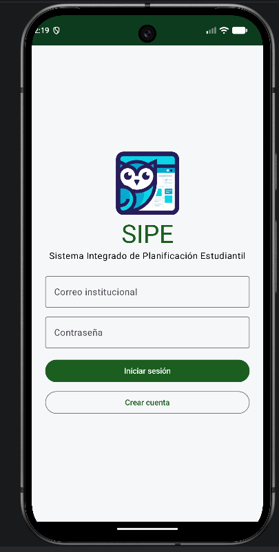
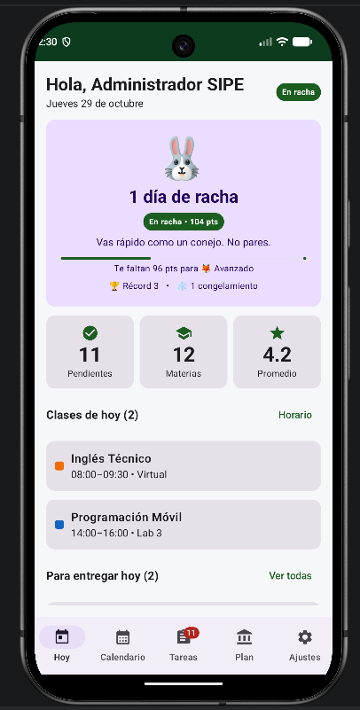
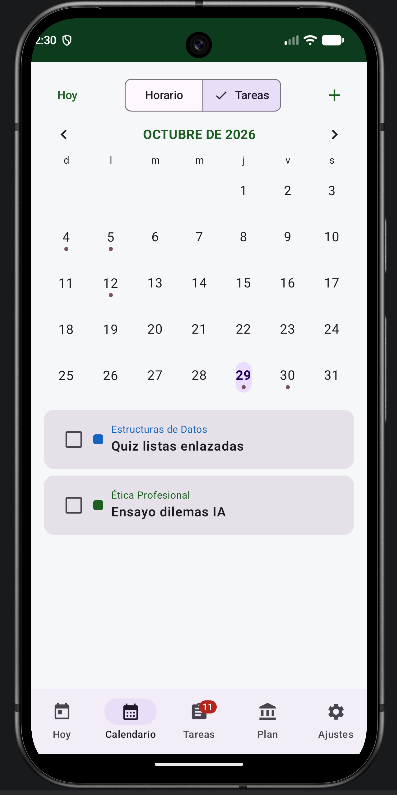
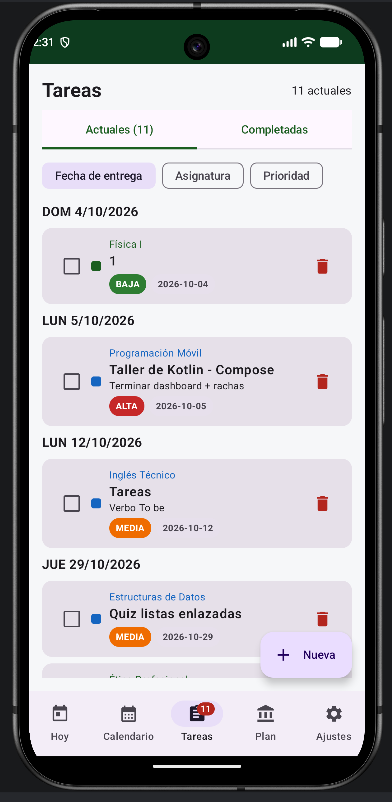
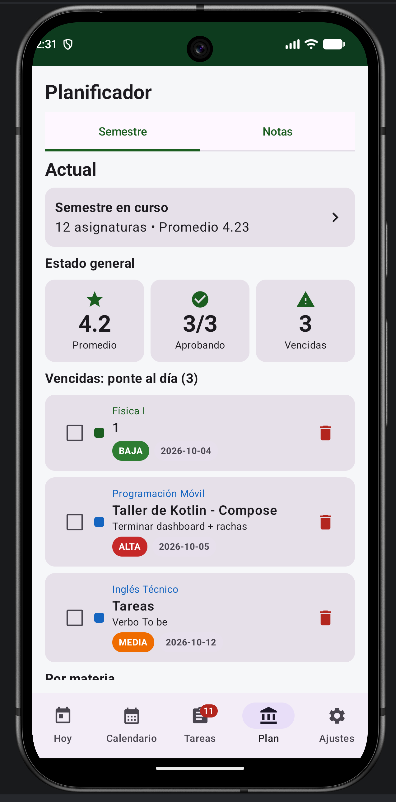
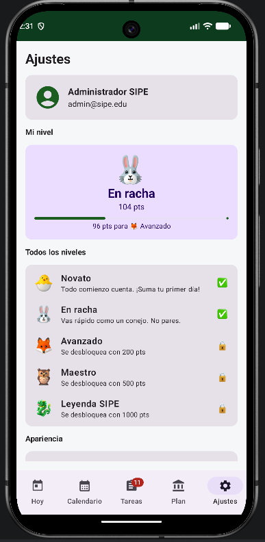
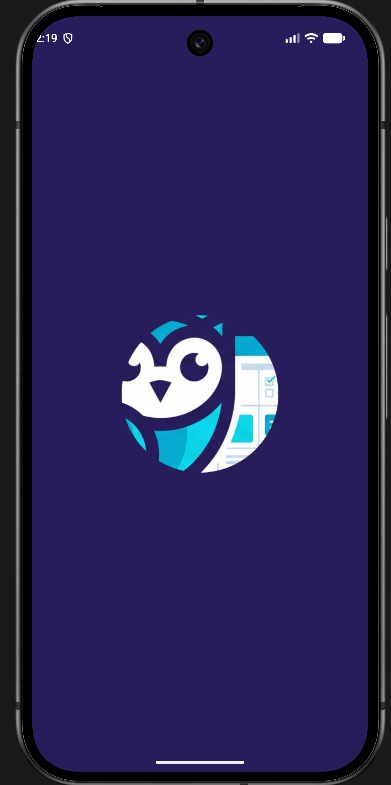
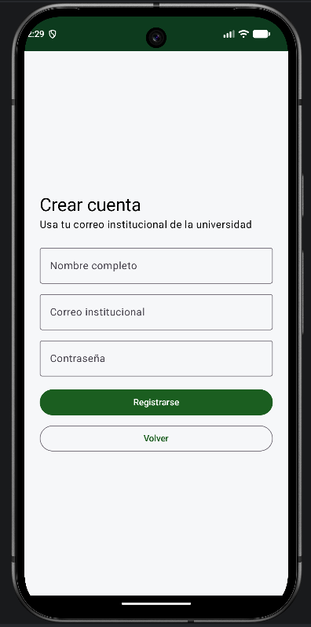
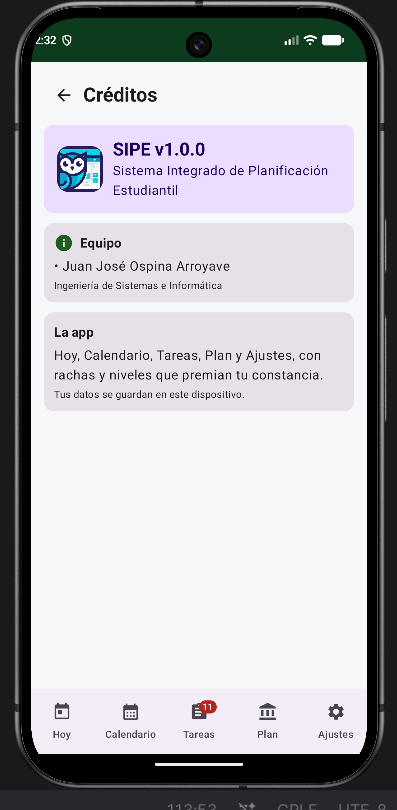

<p align="center">
  
</p>

<h1 align="center">SIPE</h1>

<p align="center">
  <b>Sistema Integrado de Planificación Estudiantil</b><br>
  Horario, tareas, notas y rachas de estudio en una sola app Android, 100 % sin internet.
</p>

<p align="center">
  
  
  
  
  
  
</p>

<p align="center">
  <a href="#-características">Características</a> ·
  <a href="#-capturas">Capturas</a> ·
  <a href="#️-arquitectura-mvvm-por-capas">Arquitectura</a> ·
  <a href="#-cómo-ejecutar">Cómo ejecutar</a> ·
  <a href="#-publicación">Publicación</a> ·
  <a href="#-diseño">Diseño</a>
</p>

---

> **SIPE** es la app de tu universidad para organizar la vida académica: horario de clases, tareas y recordatorios, notas con promedio ponderado, resumen del semestre y un **sistema de rachas** que te motiva a estudiar todos los días.
> Está pensada para que una institución la adopte como su app estudiantil. Funciona **100 % sin internet**: todos los datos se guardan en el dispositivo.

## ✨ Características

- 📅 **Hoy:** agenda del día con las clases y las entregas pendientes.
- 🗓️ **Calendario mensual:** cambia entre la vista de horario y la de tareas.
- ✅ **Tareas:** prioridad, asignatura y fecha de entrega; se pueden ordenar y filtrar.
- 📊 **Planificador:** estado del semestre, promedio ponderado y tareas vencidas.
- 🔥 **Rachas y niveles:** puntos, récord y congelamientos, de *Novato* a *Leyenda SIPE*.
- 🔒 **Privacidad:** cuentas locales con contraseña cifrada (PBKDF2 + salt) y sin servidores.

## 📸 Capturas

<table>
  <tr>
    <td align="center"><br><sub>Inicio de sesión</sub></td>
    <td align="center"><br><sub>Hoy</sub></td>
    <td align="center"><br><sub>Calendario</sub></td>
  </tr>
  <tr>
    <td align="center"><br><sub>Tareas</sub></td>
    <td align="center"><br><sub>Planificador</sub></td>
    <td align="center"><br><sub>Ajustes y niveles</sub></td>
  </tr>
  <tr>
    <td align="center"><br><sub>Splash</sub></td>
    <td align="center"><br><sub>Registro</sub></td>
    <td align="center"><br><sub>Créditos</sub></td>
  </tr>
</table>

---

## 📱 Pantallas

| Pantalla | Ruta | Archivo |
|---|---|---|
| Splash (marca) | arranque | `MainActivity.kt` + `Theme.SIPE.Splash` |
| Login / Registro | `login`, `register` | `ui/screens/auth/AuthScreens.kt` |
| Hoy (agenda + racha) | `home` | `ui/screens/home/HoyScreen.kt` |
| Calendario mensual | `calendar` | `ui/screens/calendar/CalendarScreen.kt` |
| Tareas / Nueva tarea | `tasks`, `task_form` | `ui/screens/tasks/TasksScreens.kt` |
| Horario de clases | `classes` | `ui/screens/classes/ClassesScreens.kt` |
| Detalle de materia | `class/{id}` | `ui/screens/classes/ClassesScreens.kt` |
| Planificador (Semestre / Notas) | `plan` | `ui/screens/plan/PlanScreen.kt` |
| Ajustes | `settings` | `ui/screens/settings/SettingsScreens.kt` |
| Créditos (estudiante) | `about` | `ui/screens/settings/SettingsScreens.kt` |
| Componentes compartidos | — | `ui/screens/components/SipeComponents.kt` |

---

## 🏗️ Arquitectura: MVVM por capas

```text
┌─────────────────────────────────────┐
│ UI (Jetpack Compose + Navigation)   │  ui/
├─────────────────────────────────────┤
│ ViewModels (StateFlow)              │  ui/
├─────────────────────────────────────┤
│ Repository                          │  data/
├─────────────────────────────────────┤
│ Room (SQLite local) + DataStore     │  data/
├─────────────────────────────────────┤
│ Domain (reglas puras: rachas, etc.) │  domain/
└─────────────────────────────────────┘
```

- **Regla de dependencias:** `UI → ViewModel → Repository → Data`. La UI nunca toca la base de datos directamente.
- **Lógica de rachas pura:** testeable en JVM sin Android (`StreakCalculatorTest`).
- **Persistencia offline-first:** Room + DataStore, sin servidor ni Firebase en la entrega.

---

## 🛠️ Stack tecnológico

| Componente | Versión |
|---|---|
| Lenguaje | Kotlin 2.0.20 (JVM 17) |
| UI | Jetpack Compose BOM 2024.10.00 + Material 3 |
| Navegación | Navigation Compose 2.7.7 |
| Base de datos | Room 2.6.1 (KSP) |
| Preferencias | DataStore Preferences 1.1.1 |
| Pruebas | JUnit 4.13.2 |
| Build | Gradle 8.13 / AGP 8.13.2 |
| SDK | minSdk 26 · compileSdk/targetSdk 36 |
| ID de aplicación | `com.sipe.app` · `1.0.1` (versionCode 2) |

---

## 🗄️ Base de datos: Room (nativa de Android)

Se usa **Room** porque es la vía nativa recomendada por Android: verifica SQL en compilación, expone `Flow` reactivo a Compose, soporta migraciones y funciona totalmente offline.

**Tablas (`SipeDatabase` v2):**

| Tabla | Campos clave |
|---|---|
| `users` | id, name, email (único), passwordHash (PBKDF2 + salt), university, career |
| `courses` | id, name, professor, classroom, dayOfWeek, startTime, endTime, credits, colorHex |
| `tasks` | id, title, description, courseName, dueDate, priority, done |
| `grades` | id, courseName, label, value (0–5), weight (0–1) |
| `goals` | id, title, target, progress |

**DataStore (`sipe_prefs`):** sesión, racha (current, best, points, freezes, lastDate) y tema oscuro.

---

## 📂 Estructura del repositorio

```
app/src/main/java/com/sipe/app/
  MainActivity.kt · SipeApplication.kt
  data/       Entities.kt · SipeDatabase.kt · Security.kt · SessionManager.kt · SipeRepository.kt
  domain/     StreakCalculator.kt · Levels.kt
  ui/         AppViewModels.kt · theme/ · nav/AppNav.kt
  ui/screens/ auth/ · home/ · calendar/ · tasks/ · classes/ · plan/ · settings/ · components/
app/src/main/res/
  drawable-nodpi/ic_logo_mark.png   (logo en la app)
  mipmap-*/ic_launcher(.png)        (icono adaptativo por densidad)
  values/  strings, colors, themes
app/src/test/  StreakCalculatorTest.kt
docs/  brand/ · capturas/ · play/ · wireframes_papel/ · ESTADO.md · PUBLICACION.md · WIREFRAMES.md · PRESENTACION.md
```

---

## 🚀 Cómo ejecutar

1. Clona el repositorio:
   ```bash
   git clone https://github.com/juann11/App_Nativa_SIPE.git
   ```
2. Ábrelo en **Android Studio** (Hedgehog o superior) y sincroniza Gradle.
3. Conecta un **dispositivo físico Android** con depuración USB activada y da **Run**.
4. Inicia sesión con la cuenta de demostración:
   - Correo: `admin@sipe.edu`
   - Contraseña: `Admin123`

Ejecutar pruebas unitarias de rachas:
```bash
./gradlew :app:testDebugUnitTest
```

---

## 📦 Publicación

La aplicación está firmada y lista para publicar en Google Play:

- **App Bundle firmado:** `app/release/app-release.aab` (versión 1.0.1, 4.4 MB)
- **Firma:** Play App Signing. Google guarda la clave de la app y la clave de subida se queda fuera del repositorio (`.gitignore` la protege)
- **Ficha de tienda:** nombre, descripciones, icono 512×512 y capturas en [`docs/play/`](docs/play/)
- **Proceso completo:** [`docs/PUBLICACION.md`](docs/PUBLICACION.md)

---

## 🎨 Diseño

**Logo original:** [`docs/brand/logo_original.jpg`](docs/brand/logo_original.jpg)

**Wireframes digitales (Figma):**  
👉 [https://www.figma.com/design/WxLn39PaUl9Ev3NVi8s5r6/SIPE?node-id=0-1&p=f&t=srasZ0yfTNVzsDPD-0](https://www.figma.com/design/WxLn39PaUl9Ev3NVi8s5r6/SIPE?node-id=0-1&p=f&t=srasZ0yfTNVzsDPD-0)

**Wireframes en papel:** fotos en [`docs/wireframes_papel/`](docs/wireframes_papel/).

Las 12 pantallas diseñadas cubren: Splash, Login, Registro, Hoy, Calendario, Tareas, Horario, Detalle de materia, Formulario de tarea, Planificador, Ajustes y Créditos.

---

## 👥 Equipo

- **Juan José Ospina Arroyave** — Ingeniería de Sistemas e Informática

---

## 📄 Licencia

Este proyecto se desarrolla como parte de la **Entrega 3 - APP Nativa** del curso de Aplicaciones Móviles.
