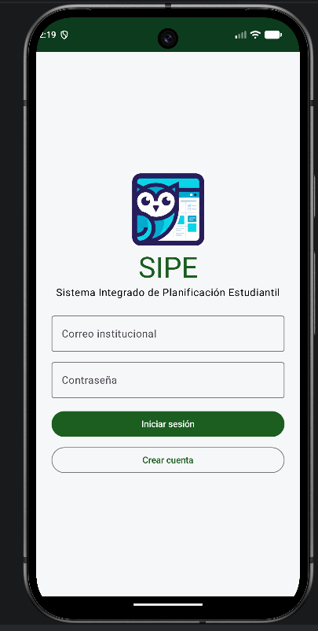
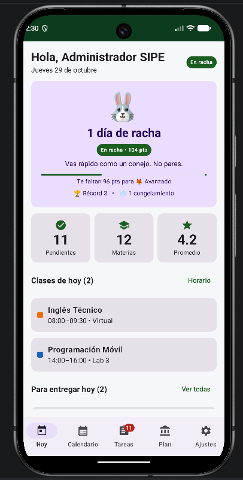
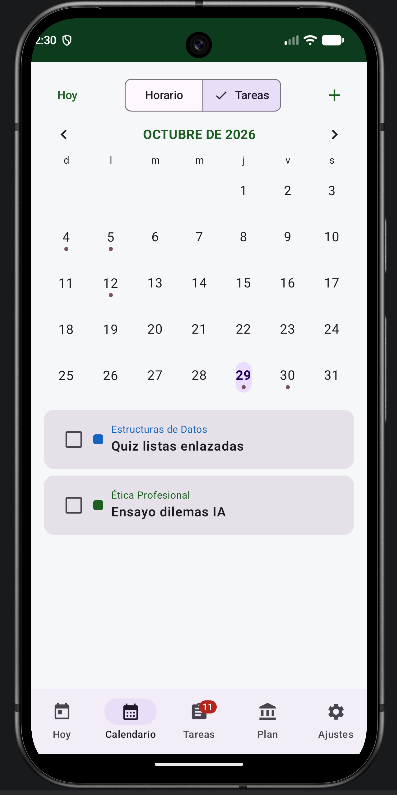
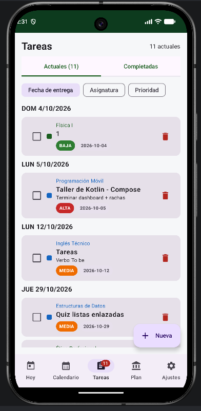
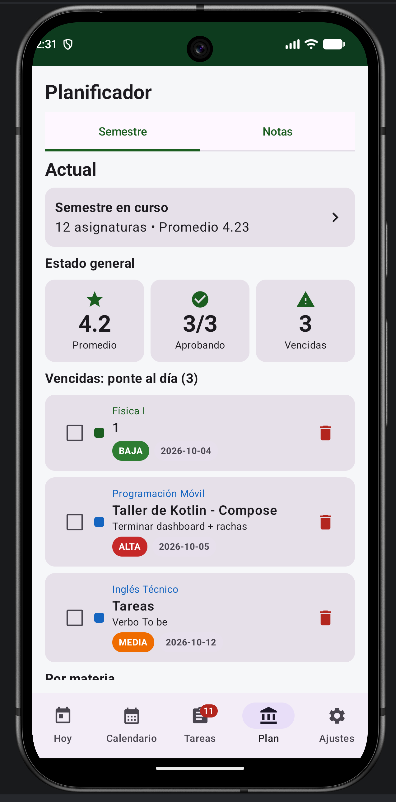
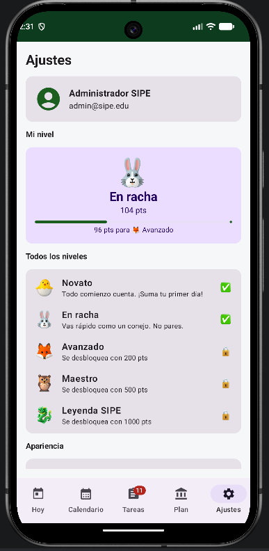

<p align="center">
  
</p>

<h1 align="center">SIPE: presentación Entrega 3</h1>

<p align="center">
  <b>Sistema Integrado de Planificación Estudiantil</b><br>
  App nativa Android · Kotlin + Jetpack Compose · 10 minutos
</p>

<p align="center">
  Juan José Ospina Arroyave · Ingeniería de Sistemas e Informática · Aplicaciones Móviles
</p>

---

## Agenda

| # | Tema | Tiempo |
|---|---|---|
| 1 | El problema | 1 min |
| 2 | Arquitectura | 2 min |
| 3 | Demo de las vistas | 3 min |
| 4 | Sistema de rachas | 2 min |
| 5 | Publicación en Google Play | 2 min |

---

## 1. El problema (1 min)

Los estudiantes tienen su vida académica repartida entre WhatsApp, el calendario del celular, cuadernos y hojas de notas. Así se pasan entregas y nadie sabe cómo va su promedio hasta que es tarde.

**La propuesta:** SIPE como la **app oficial de la universidad** (modelo B2B): la institución la adopta y cada estudiante tiene en un solo lugar su horario, sus tareas, sus notas y un incentivo para estudiar todos los días.

- Funciona **100 % sin internet**: los datos se guardan en el dispositivo.
- Cuentas locales con contraseña cifrada (PBKDF2 + salt).

---

## 2. Arquitectura (2 min)

Patrón **MVVM por capas**: cada capa solo habla con la de abajo, así la UI nunca toca la base de datos directamente.

```text
┌─────────────────────────────────────┐
│ UI (Jetpack Compose + Navigation)   │  ui/
├─────────────────────────────────────┤
│ ViewModels (StateFlow)              │  ui/AppViewModels.kt
├─────────────────────────────────────┤
│ Repository                          │  data/SipeRepository.kt
├─────────────────────────────────────┤
│ Room (SQLite local) + DataStore     │  data/SipeDatabase.kt · SessionManager.kt
├─────────────────────────────────────┤
│ Dominio (reglas puras)              │  domain/StreakCalculator.kt · Levels.kt
└─────────────────────────────────────┘
```

**Archivos para mostrar en vivo:**
- [`SipeApplication.kt`](../app/src/main/java/com/sipe/app/SipeApplication.kt): crea la base de datos y el repositorio una sola vez.
- [`SipeRepository.kt`](../app/src/main/java/com/sipe/app/data/SipeRepository.kt): punto único de acceso a los datos.
- [`SessionManager.kt`](../app/src/main/java/com/sipe/app/data/SessionManager.kt): sesión y racha en DataStore.

**¿Por qué Room?** Es la opción nativa que recomienda Android: valida el SQL al compilar, entrega `Flow` reactivo que Compose redibuja solo y funciona sin conexión.

---

## 3. Demo de las vistas (3 min)

Demo en vivo en el **dispositivo físico**, con este recorrido:

**Login → Hoy (racha) → Calendario → Tareas → Planificador → Ajustes → Créditos**

<table>
  <tr>
    <td align="center"><br><sub>1. Inicio de sesión</sub></td>
    <td align="center"><br><sub>2. Hoy: racha y clases del día</sub></td>
    <td align="center"><br><sub>3. Calendario mensual</sub></td>
  </tr>
  <tr>
    <td align="center"><br><sub>4. Tareas por fecha y prioridad</sub></td>
    <td align="center"><br><sub>5. Planificador y promedio</sub></td>
    <td align="center"><br><sub>6. Ajustes y niveles</sub></td>
  </tr>
</table>

> Plan B si falla el dispositivo: estas capturas están en [`docs/capturas/`](capturas/).

---

## 4. Sistema de rachas (2 min)

Un día cuenta como activo cuando el estudiante **abre la app o completa una tarea**. Las reglas viven en [`StreakCalculator.kt`](../app/src/main/java/com/sipe/app/domain/StreakCalculator.kt) y se llaman desde `registerDailyActivity()` en `SessionManager`.

| Situación | Racha | Puntos |
|---|---|---|
| Primer día o día consecutivo | +1 | **+10** |
| Otra actividad el mismo día | igual | +2 |
| Cada 7 días seguidos | +1 | **+50 de bonus** y +1 congelamiento (máx. 3) |
| Faltó 1 día y tiene congelamiento | continúa | se gasta el congelamiento |
| Faltó más tiempo | vuelve a 1 | +10 |

**Niveles** (en [`Levels.kt`](../app/src/main/java/com/sipe/app/domain/Levels.kt)):

| Nivel | Puntos |
|---|---|
| 🐣 Novato | 0 |
| 🐰 En racha | 50 |
| 🦊 Avanzado | 200 |
| 🦉 Maestro | 500 |
| 🐉 Leyenda SIPE | 1000 |

**¿Por qué así?** Es la misma mecánica de las apps de idiomas: perder la racha "duele", y eso hace que el estudiante abra la app todos los días. El congelamiento evita que un solo mal día lo desanime.

La lógica es Kotlin puro, sin Android, así que se prueba en la JVM con [`StreakCalculatorTest`](../app/src/test/java/com/sipe/app/domain/StreakCalculatorTest.kt).

---

## 5. Publicación en Google Play (2 min)

| Paso | Estado |
|---|---|
| App Bundle (`.aab`) firmado, versión **1.0.1** (versionCode 2) | ✅ |
| Firma con **Play App Signing**: Google guarda la clave de la app | ✅ |
| Clave de subida fuera del repositorio (`*.jks` en `.gitignore`) | ✅ |
| Ficha de la tienda: nombre, descripciones e icono 512×512 en [`docs/play/`](play/) | ✅ |
| Target API 36 (requisito actual de Play) | ✅ |
| Track de **prueba interna** con acceso para `lasmovies@gmail.com` | Mostrar en Play Console |

**Lección aprendida:** la clave de subida se perdió a mitad del proceso. Como la app usa Play App Signing, se pudo **pedir el cambio de la clave de subida** desde *Protegida con Play → Firma de aplicaciones* sin perder la app. Moraleja: guardar el `.jks` y su contraseña en un gestor de contraseñas desde el primer día.

---

## Cierre

- **Diseño:** [Figma (flujo, wireframes en gris y UI a color)](https://www.figma.com/design/WxLn39PaUl9Ev3NVi8s5r6/SIPE?node-id=0-1&p=f&t=srasZ0yfTNVzsDPD-0) · [wireframes en papel](wireframes_papel/)
- **Código:** este repositorio
- **Próximos pasos:**
  - Firebase para varias universidades y sincronizar entre dispositivos.
  - Notificaciones push (FCM) para recordar entregas.
  - Importar el horario directamente desde el sistema de la universidad.

<p align="center"><b>¡Gracias! ¿Preguntas?</b></p>
